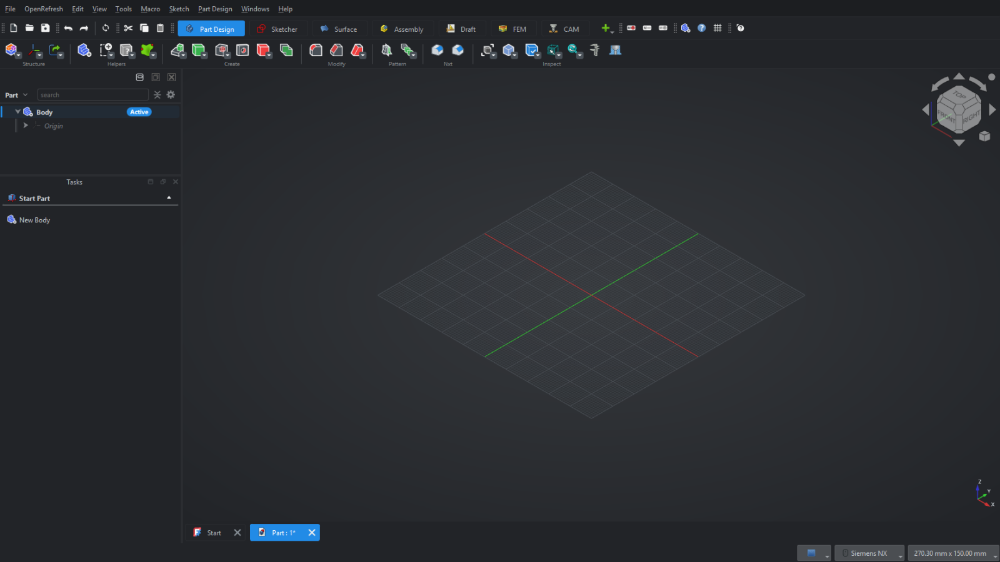
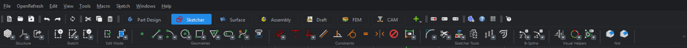

# OpenRefresh

OpenRefresh is an add-on for FreeCAD 1.1. It makes the FreeCAD user interface
faster and easier to use. OpenRefresh uses two other add-ons: OpenTheme and Nxt.


> **Status:** This is version 0.1.0. It is a test version and it can have
> problems. To tell us about a problem, see [Problems](#problems).

## Functions

### New part and new assembly

OpenRefresh gives two commands that make a new document:

- **New part** (Ctrl+Alt+P) makes a new document with an active body.
- **New assembly** (Ctrl+Alt+A) makes a new document with an active assembly.

Each new document opens in the isometric view. The origin is at the center of
the view, and the view shows approximately 150 mm of the model. OpenRefresh shows the
grid on the XY plane.



### Grid

OpenRefresh shows the grid in each new 3D view. It also does this for documents
that you make with **File → New** or with the Start page. OpenRefresh also
shows the grid when you edit a sketch.

To show the grid in the active 3D view, push Ctrl+Alt+G.


### Two toolbar rows

OpenRefresh puts the toolbars in two rows:

- The top row has small icons. It has the file commands, the edit commands and
  the workbench tabs.
- The bottom row has large icons. It has the tools of the active workbench, in
  groups. A caption below each group gives the name of the group.

OpenRefresh puts the toolbars in the two rows again each time that you change
the workbench.




The workbench tabs show seven workbenches: Part Design, Sketcher, Surface,
Assembly, Draft, FEM and CAM. To open a different workbench, click **+** at the
end of the tabs.

### Menus of related commands

Some buttons in the bottom row have a small triangle in the bottom-right
corner. Click the triangle to open a menu of related commands. Click the icon
to start the command that the button shows.

For example, the arc button has five commands in its menu. These are the center
arc, the 3-point arc and three types of conic arc. After you use a command from
the menu, the button shows that command.


### Setup wizard

The setup wizard lets you change some of your FreeCAD preferences. OpenRefresh
does not change a preference that you do not select. OpenRefresh records each
change that it makes. Then you can put back all your previous preferences with
one button.


You can select these changes:

- **Workbench tabs:** Show the workbenches as tabs.
- **Trim the workbench list:** Show only seven workbenches as tabs.
- **Grid everywhere:** Show the grid in all the workbenches.
- **OpenDark theme:** Use the dark theme from OpenTheme.
- **Flat icon set:** Use flat icons for approximately 380 commands.
- **Auto-body on File → New:** Add a body to each new document.

## Commands and shortcuts

All these commands are in the **OpenRefresh** menu.

| Menu command | Function | Shortcut |
|---|---|---|
| **New part** | Makes a new document with an active body. | Ctrl+Alt+P |
| **New assembly** | Makes a new document with an active assembly. | Ctrl+Alt+A |
| **Show grid** | Shows the grid in the active 3D view. | Ctrl+Alt+G |
| **Auto-body on new document** | Sets on or off: add a body to each document from **File → New**. | None |
| **Grouped toolbar with captions** | Sets on or off: show the bottom row as groups with captions. | None |
| **OpenRefresh setup…** | Opens the setup wizard. | None |

To change a shortcut, click **Tools → Customize**. Then use the **Keyboard**
tab.

## Necessary software

- FreeCAD 1.1.0 or a later version.
- The OpenTheme add-on and the Nxt add-on. The Addon Manager installs them
  with OpenRefresh.

## Install

### Install with the Addon Manager

Use this procedure when OpenRefresh is in the FreeCAD addon index.

1. Start FreeCAD.
2. Click **Tools → Addon manager**.
3. Find **OpenRefresh** in the list.
4. Click **Install**.
5. Start FreeCAD again.

### Install manually

Use this procedure when OpenRefresh is not in the FreeCAD addon index.

> **NOTE:** You must also install OpenTheme and Nxt. Install them with the
> Addon Manager before you do this procedure.

1. Start FreeCAD.
2. Click **View → Panels → Python console**.
3. In the Python console, type this command:

   ```python
   FreeCAD.getUserAppDataDir()
   ```

4. Push Enter.
5. Find the path that the Python console shows.
6. Close FreeCAD.
7. Find the `Mod` folder in that path. If there is no `Mod` folder, make it.
8. Open a terminal in the `Mod` folder.
9. Type this command:

   ```sh
   git clone https://github.com/zg-intramotev/FC-OpenRefresh.git
   ```

10. Start FreeCAD.

## Start OpenRefresh for the first time

When FreeCAD starts with OpenRefresh for the first time, the setup wizard
opens.

1. Select the check box for each change to make.
2. Click **Apply**.
3. Read the list of changes.
4. Start FreeCAD again.

FreeCAD shows the workbench tabs, the OpenDark theme and the flat icons only
after it starts again.

To make no changes, click **Skip**. To open the setup wizard again, click
**OpenRefresh → OpenRefresh setup…**.

## Remove OpenRefresh

> **CAUTION:** Put back your previous preferences before you remove
> OpenRefresh. If you do not do this, the changes from the setup wizard stay in
> FreeCAD.

1. Click **OpenRefresh → OpenRefresh setup…**.
2. Click **Restore my previous settings**.
3. Click **Yes**.
4. Click **Tools → Addon manager**.
5. Select **OpenRefresh** in the list.
6. Click **Uninstall**.
7. Start FreeCAD again.

If you installed OpenRefresh manually, remove the `FC-OpenRefresh` folder from
the `Mod` folder. Do this step instead of steps 4 to 6.

After you remove OpenRefresh, FreeCAD shows all its usual toolbars again.

## Problems

To tell us about a problem, open an issue at
<https://github.com/zg-intramotev/FC-OpenRefresh/issues>. Give your FreeCAD
version. To find the version, click **Help → About FreeCAD → Copy to
clipboard**.

You can also do the self-test and attach the results to the issue. The
self-test opens and closes some new documents. It does not change your files.

1. Close FreeCAD.
2. Start FreeCAD with the self-test script. On Windows, type this command:

   ```sh
   freecad.exe "<OpenRefresh folder>\tests\gui_selftest.py"
   ```

3. Wait approximately 2 minutes. FreeCAD closes when the test is complete.
4. Find the `openrefresh_selftest` folder in your FreeCAD user data folder.
5. Attach the `report.json` file from this folder to the issue.

## OpenTheme and Nxt

OpenRefresh uses two add-ons from Obelisk79. The Addon Manager installs them
with OpenRefresh.

- **[OpenTheme](https://github.com/obelisk79/OpenTheme)** gives light and dark
  themes with high contrast. The setup wizard can set the OpenDark theme. The
  flat icons are for dark themes.
- **[Nxt](https://github.com/obelisk79/FreeCAD-Nxt)** gives a model panel, a
  history bar, a fillet tool, a chamfer tool and section views. Its tools are
  in the **Nxt** group of the bottom row.

## Limits

- OpenRefresh operates only with FreeCAD 1.1.0 or a later version.
- The flat icons are for approximately 380 commands in Part, Part Design,
  Sketcher and the view commands. The other workbenches keep their usual icons.
- The flat icons are for dark themes. With a light theme, some icons can be
  difficult to see.
- The bottom row does not show the usual FreeCAD toolbars. To see them, click
  **OpenRefresh → Grouped toolbar with captions**.
- OpenRefresh and Nxt are test versions. They can have problems.

## License

- OpenRefresh has the GNU Lesser General Public License, version 2.1 or a
  later version (LGPL-2.1-or-later). See [LICENSE](LICENSE).
- The flat icons in `freecad/openrefresh/resources/flat-icons/` have the
  CC0 1.0 license (public domain). See the `LICENSE` and `NOTICE.md` files in
  that folder.

## Credits

- Flat icons: [FreeCAD-Flat-Icons](https://github.com/obelisk79/FreeCAD-Flat-Icons)
  (CC0 1.0). OpenRefresh uses these icons without changes.
- Colors: the [open-color](https://github.com/yeun/open-color) palette.
- [OpenTheme](https://github.com/obelisk79/OpenTheme) and
  [Nxt](https://github.com/obelisk79/FreeCAD-Nxt), by Obelisk79.
- The FreeCAD project and its users: <https://www.freecad.org>.
