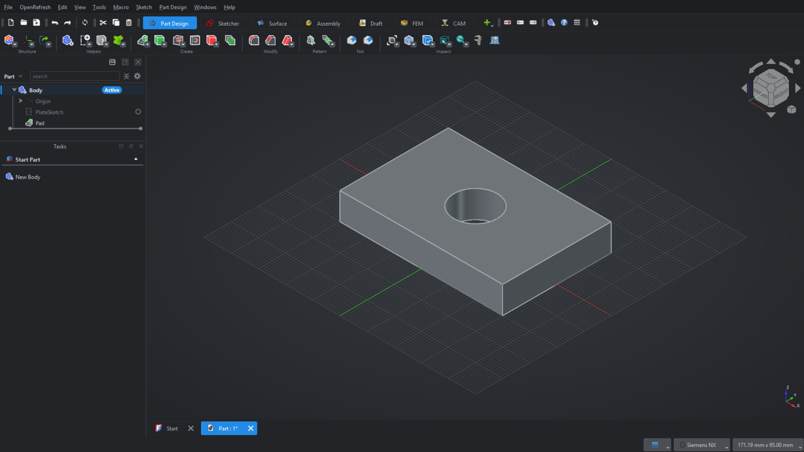
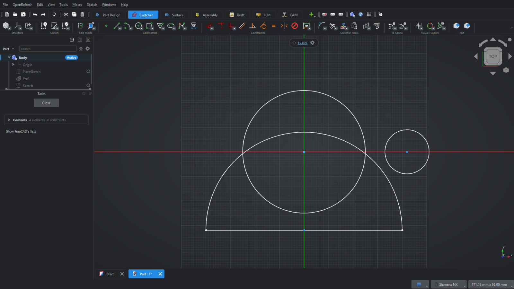
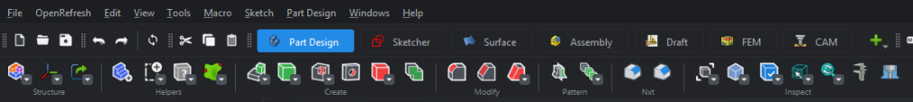
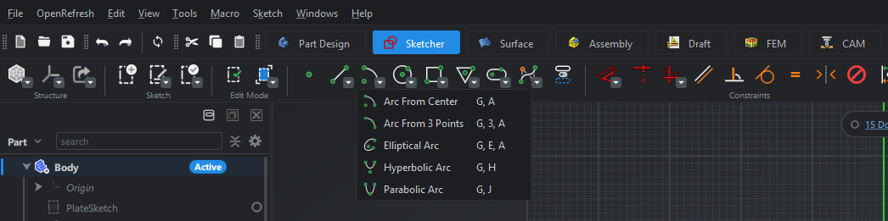
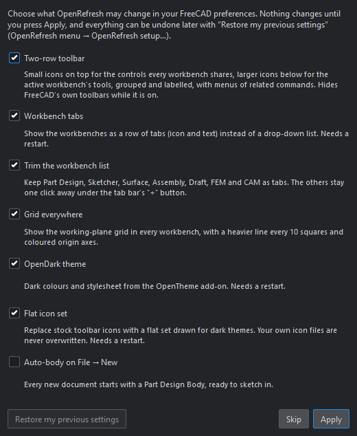

# OpenRefresh

OpenRefresh is an add-on for FreeCAD 1.1. It reorganizes the toolbars into two
rows, can put the workbenches on tabs, and adds commands that start a new part or
assembly ready to model in. It is built on [OpenTheme](https://github.com/obelisk79/OpenTheme)
and [Nxt](https://github.com/obelisk79/FreeCAD-Nxt), two add-ons by Obelisk79,
and needs both of them installed.

None of your FreeCAD preferences change until you choose them in the setup
wizard, and the wizard can put them all back.



> **Status:** 0.1.0, the first release. Expect rough edges. If something
> breaks, see [Problems](#problems).

## Functions

### New part and new assembly

**New part** (Ctrl+Alt+P) creates a document that already contains a Part
Design body and makes that body active, so the next step can be a sketch.
**New assembly** (Ctrl+Alt+A) does the same with an empty assembly.

Both open in an isometric view centered on the origin, framed to about 150 mm,
with the grid on the XY plane. Documents created with **File → New** or from
the Start page get the same view while they are still empty.


### Grid

FreeCAD's working-plane grid belongs to the Draft workbench and normally
disappears when you leave Draft. OpenRefresh turns it on for each new 3D view,
including while you edit a sketch, and the setup wizard can keep it visible in
every workbench. Ctrl+Alt+G brings it back in the current view.



### Two toolbar rows

The top row uses small icons and holds the things you need in every
workbench: file and edit commands, cut, copy and paste, the OpenRefresh
buttons, and the workbench tabs. The bottom row uses larger icons for the
active workbench's own tools, grouped under captions such as Create, Modify
and Pattern, with the view and measuring tools at the right-hand end under
Inspect.




FreeCAD rebuilds its toolbars every time you switch workbench, and on its own
it does not keep them on separate rows. OpenRefresh lays the two rows out again
after each switch, so they stay where you left them.

With the setup wizard's workbench options applied, the tabs show Part Design,
Sketcher, Surface, Assembly, Draft, FEM and CAM. The **+** at the end of the
tab bar lists every other workbench.

### Menus of related commands

FreeCAD already groups some commands. The arc button, for instance, holds five
kinds of arc. OpenRefresh keeps those groups and adds its own where related
commands used to sit side by side: Pad with Revolution, Loft, Pipe and Helix,
or Pocket with Groove and the subtractive versions of the same. The Part
Design row goes from about 45 buttons to 27.

A grouped button has a small grey badge with an arrow in its lower-right
corner. Click the badge to open the menu, or the icon to run the command it
shows. Once you pick something from the menu, the button shows that command
until you pick another.



### Setup wizard

The first time FreeCAD starts with OpenRefresh, a setup window offers six
changes to your preferences, each with its own checkbox: workbench tabs, a
shorter workbench list, the grid in every workbench, the OpenDark theme, the
flat icon set, and a body in every document made with **File → New**. Only the
ones you tick are applied.

OpenRefresh keeps a record of the previous value of every preference it
changes. **Restore my previous settings** in the same window uses that record
to undo all of it, and removes the flat icons it installed.



## Commands and shortcuts

All these commands are in the **OpenRefresh** menu.

| Menu command | Function | Shortcut |
|---|---|---|
| **New part** | Makes a new document with an active body. | Ctrl+Alt+P |
| **New assembly** | Makes a new document with an active assembly. | Ctrl+Alt+A |
| **Show grid** | Shows the grid in the active 3D view. | Ctrl+Alt+G |
| **Auto-body on new document** | Sets on or off: add a body to each document from **File → New**. | None |
| **Grouped toolbar with captions** | Sets on or off: show the bottom row as groups with captions. | None |
| **OpenRefresh setup…** | Opens the setup wizard. | None |

To change a shortcut, click **Tools → Customize**. Then use the **Keyboard**
tab.

## Necessary software

- FreeCAD 1.1.0 or a later version.
- The OpenTheme add-on and the Nxt add-on. The Addon Manager installs them
  with OpenRefresh.

## Install

### Install with the Addon Manager

Use this procedure when OpenRefresh is in the FreeCAD addon index.

1. Start FreeCAD.
2. Click **Tools → Addon manager**.
3. Find **OpenRefresh** in the list.
4. Click **Install**.
5. Start FreeCAD again.

### Install manually

Use this procedure when OpenRefresh is not in the FreeCAD addon index.

> **NOTE:** You must also install OpenTheme and Nxt. Install them with the
> Addon Manager before you do this procedure.

1. Start FreeCAD.
2. Click **View → Panels → Python console**.
3. In the Python console, type this command:

   ```python
   FreeCAD.getUserAppDataDir()
   ```

4. Push Enter.
5. Find the path that the Python console shows.
6. Close FreeCAD.
7. Find the `Mod` folder in that path. If there is no `Mod` folder, make it.
8. Open a terminal in the `Mod` folder.
9. Type this command:

   ```sh
   git clone https://github.com/zg-intramotev/FC-OpenRefresh.git
   ```

10. Start FreeCAD.

## Start OpenRefresh for the first time

When FreeCAD starts with OpenRefresh for the first time, the setup wizard
opens.

1. Select the check box for each change to make.
2. Click **Apply**.
3. Read the list of changes.
4. Start FreeCAD again.

FreeCAD shows the workbench tabs, the OpenDark theme and the flat icons only
after it starts again.

To make no changes, click **Skip**. To open the setup wizard again, click
**OpenRefresh → OpenRefresh setup…**.

## Remove OpenRefresh

> **CAUTION:** Put back your previous preferences before you remove
> OpenRefresh. If you do not do this, the changes from the setup wizard stay in
> FreeCAD.

1. Click **OpenRefresh → OpenRefresh setup…**.
2. Click **Restore my previous settings**.
3. Click **Yes**.
4. Click **Tools → Addon manager**.
5. Select **OpenRefresh** in the list.
6. Click **Uninstall**.
7. Start FreeCAD again.

If you installed OpenRefresh manually, remove the `FC-OpenRefresh` folder from
the `Mod` folder. Do this step instead of steps 4 to 6.

After you remove OpenRefresh, FreeCAD shows all its usual toolbars again.

## Problems

To tell us about a problem, open an issue at
<https://github.com/zg-intramotev/FC-OpenRefresh/issues>. Give your FreeCAD
version. To find the version, click **Help → About FreeCAD → Copy to
clipboard**.

You can also do the self-test and attach the results to the issue. The
self-test opens and closes some new documents. It does not change your files.

1. Close FreeCAD.
2. Start FreeCAD with the self-test script. On Windows, type this command:

   ```sh
   freecad.exe "<OpenRefresh folder>\tests\gui_selftest.py"
   ```

3. Wait approximately 2 minutes. FreeCAD closes when the test is complete.
4. Find the `openrefresh_selftest` folder in your FreeCAD user data folder.
5. Attach the `report.json` file from this folder to the issue.

## OpenTheme and Nxt

OpenRefresh uses two add-ons from Obelisk79. The Addon Manager installs them
with OpenRefresh.

- **[OpenTheme](https://github.com/obelisk79/OpenTheme)** gives light and dark
  themes with high contrast. The setup wizard can set the OpenDark theme. The
  flat icons are for dark themes.
- **[Nxt](https://github.com/obelisk79/FreeCAD-Nxt)** gives a model panel, a
  history bar, a fillet tool, a chamfer tool and section views. Its tools are
  in the **Nxt** group of the bottom row.

## Limits

- OpenRefresh operates only with FreeCAD 1.1.0 or a later version.
- The flat icons are for approximately 380 commands in Part, Part Design,
  Sketcher and the view commands. The other workbenches keep their usual icons.
- The flat icons are for dark themes. With a light theme, some icons can be
  difficult to see.
- The bottom row does not show the usual FreeCAD toolbars. To see them, click
  **OpenRefresh → Grouped toolbar with captions**.
- OpenRefresh and Nxt are test versions. They can have problems.

## License

- OpenRefresh has the GNU Lesser General Public License, version 2.1 or a
  later version (LGPL-2.1-or-later). See [LICENSE](LICENSE).
- The flat icons in `freecad/openrefresh/resources/flat-icons/` have the
  CC0 1.0 license (public domain). See the `LICENSE` and `NOTICE.md` files in
  that folder.

## Credits

- Flat icons: [FreeCAD-Flat-Icons](https://github.com/obelisk79/FreeCAD-Flat-Icons)
  (CC0 1.0). OpenRefresh uses these icons without changes.
- Colors: the [open-color](https://github.com/yeun/open-color) palette.
- [OpenTheme](https://github.com/obelisk79/OpenTheme) and
  [Nxt](https://github.com/obelisk79/FreeCAD-Nxt), by Obelisk79.
- The FreeCAD project and its users: <https://www.freecad.org>.
